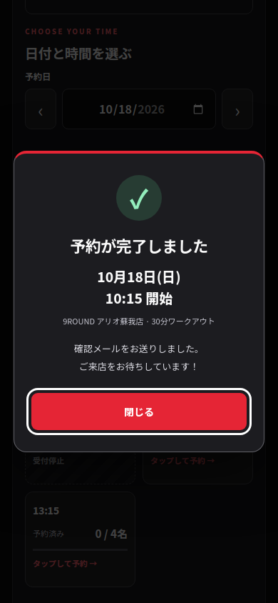
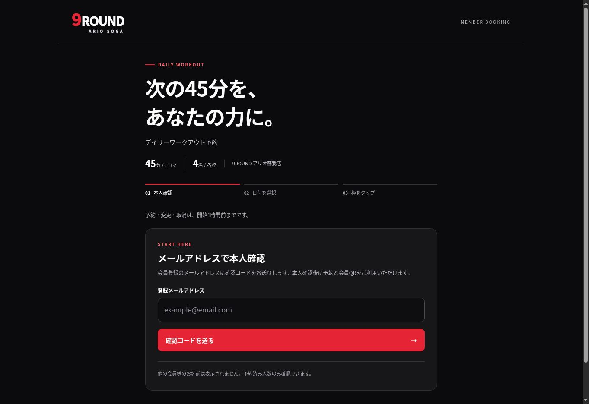

# 9ROUND アリオ蘇我店 ワークアウト予約

統合実装ブランチ：feature/9round-os-staff-integration（PWA更新元：feature/9round-installable）

**このブランチでは、A-nauts OSの専用「9ROUND予約」タブ、スタッフ・マネージャーによる変更／キャンセル、管理者による枠の設置／ブロック／削除／復元を実装しています。本番反映前です。** 詳細は[統合・権限・反映手順](docs/os-integration-20261017.md)を参照してください。

**会員向けGitHub Pages版を公開済みです（2026/10/17）。** [全会員共通の予約画面](https://forestgym-tokyo.github.io/anauts-os-reserve/9round-booking/)をホーム画面へインストールできます。本人確認・予約処理は独立GASのバージョン4を使い、従来のGAS画面・同じ予約データも維持しています。会員は登録メールの確認コード、スタッフは既存スタッフアカウントで認証します。本番の会員マスター・スタッフ名簿は読み取りのみです。ソースのconfig.jsは未接続のまま、公開ビルドだけに確認済みAPI URLを設定します。既存A-nauts GAS・マスター・トリガーは変更していません。戻し方は[公開・復旧手順](docs/pwa-release-20261017.md)を参照してください。

## 構成

| 用途 | ソース | 動作 |
| --- | --- | --- |
| 会員予約 | 9round-booking/index.html | 登録メールの確認コード → 日付 → 枠のタップで予約。ファイター登録・名前変更、予約変更・取消、会員QR表示 |
| 独立管理画面 | 9round-booking/staff/index.html | スタッフログイン、本名・ファイターネーム・受講状態確認、QR読取。STAFF/MANAGER/ADMINは予約変更・取消、ADMINはブロック・体験枠・削除・復元、ADMIN/MANAGERは未送信メール管理 |
| 独立GAS | 9round-booking/gas/ | 新規の別Apps Scriptプロジェクト専用 |
| 確認コードのコピー | 9round-booking/gas/CodeCopy.html | メールのボタンから開く専用画面。コピー後は元の予約画面へ戻る |
| 予約データ | 別の新規スプレッドシート | nr_challenges、nr_sessions、nr_fighters、nr_bookings、nr_trials、nr_blocks、nr_passes、nr_attendance、nr_changes、nr_management_actions、nr_mail |
| 会員情報 | 9ROUND会員マスター | 読み取りのみ。番号・名前・メール・会員ステータスを照合 |
| スタッフ認証 | 既存Firebase＋スタッフ名簿 | Firebaseでトークンを検証。auth_users・staffは読み取りのみ |
| A-nauts連携 | admin/admin-9round-booking.js | 専用「9ROUND予約」タブ。同じログインで予約確認・変更・取消・QR受講登録。枠管理はADMINのみ |

会員予約はA-nauts GAS・スタッフ名簿に依存しません。A-nauts側では共有ログインを使うアダプター、専用タブと関連スクリプト、SOGAスタッフに表示するナビゲーションだけを変更します。既存GASルーター・シフト・入会・退会処理は変更しません。操作は独立9ROUND APIが認証・権限・定員・期限を再検査します。

## 費用の条件

追加の有料サービス・課金契約は使用しません。公開リポジトリのGitHub Pages、GAS、Googleスプレッドシート、既存Firebaseのメール／パスワード認証を使います。Cloud Functions・Firestore・SMS認証・外部予約サービス・外部メール配信サービスを追加しません。無料上限に達した場合も、有料APIへの切替えや自動プラン変更を行いません。

メール確認コードはFirebaseのメールリンク認証を使わず、GASのMailAppで送ります。GASの送信上限は実行アカウントごとに適用され、個人Googleアカウントでは通常1日100宛先です。上限到達時は送信が失敗し、予約用コードは無効化します。既存Google／Firebaseアカウントの契約・課金設定は変更しません。

予約成立・変更・取消時にもMailAppで会員確認メールと管理通知を別々に送ります。送信待ちは専用データに保存し、予約を維持したまま管理者／マネージャーが再送できます。送信済みメールは再送しません。QRは同梱の無償ライブラリで生成・読取し、QR生成サービスや画像アップロード先を使いません。

公式資料：[GitHub Pages](https://docs.github.com/en/pages/getting-started-with-github-pages)、[Apps Scriptの割当量](https://developers.google.com/apps-script/guides/services/quotas)、[Firebase料金プラン](https://firebase.google.com/docs/projects/billing/firebase-pricing-plans)。

## デイリーワークアウト

ワークアウトは30分です。予約枠の間隔は45分、各4名を維持します。会員・スタッフ画面の枠とメールの日時には開始時刻だけを表示します。14:00〜16:15に枠はありません。下表は予約枠の内部区分です。

| 午前 | 午後 |
| --- | --- |
| 10:15〜11:00 | 16:15〜17:00 |
| 11:00〜11:45 | 17:00〜17:45 |
| 11:45〜12:30 | 17:45〜18:30 |
| 12:30〜13:15 | 18:30〜19:15 |
| 13:15〜14:00 | 19:15〜20:00 |
| | 20:00〜20:45 |

- 会員には他の会員の氏名・番号・メールを返しません。予約済み人数、ご本人の予約状態と取消ボタンのみ表示します。
- サーバーで定員・開始1時間前の締切・会員状態・ブロックを検査します。予約・変更・取消・受講登録とブロック更新は同一のScript Lockを使用します。
- 同一会員の同一枠への再送は既存予約を返し、二重登録しません。
- 管理者は枠ごと、または1日分の削除されていないデイリー枠をブロック・解除できます。成立済みの予約は自動取消しません。ブロック後も本人による取消は可能です。
- 通常スタッフはSOGA所属またはcan_9roundが有効な場合に利用できます。STAFF・MANAGER・ADMINが予約を閲覧・変更・取消でき、体験枠と枠のブロック・削除・復元はADMINだけが操作できます。
- 日付・時刻は日本時間です。

予約・変更・取消は、すべて開始1時間前までです。ちょうど1時間前は受け付け、1ミリ秒でも過ぎたら拒否します。変更時は元の枠と変更先の枠の両方の締切を検査し、変更先の空き・ブロックを確認してから1回の書き込みで入れ替えます。変更先が満員・停止中の場合は元の予約が残ります。受講済みの予約は変更・取消できません。

予約可能期間は当日から30日分、本人確認の有効時間は6時間を初期値としています。予約可能期間は1〜90日に設定変更できます。休会中・退会済み会員の新規予約は受け付けません。

未消化予約は会員ごとに最大10コマです。CONFIRMEDで、枠が終了しておらず、受講済みでない予約を全日程で合算します。取消・変更済み・受講済み・終了した枠は数えません。10コマ保有中も既存予約の日時変更は可能です。新規予約は同じScript Lock内で上限を検査し、画面にも保有数と上限を表示します。

## ファイター登録

メールアドレスと6桁コードによる本人確認後、初回はご本人の登録氏名で「○○さん、次の30分を、あなたの力に。」と表示します。「ファイター登録」で名前を保存すると、挨拶もファイターネームへ切り替わります。本人確認中はいつでも名前を変更できます。予約のための追加パスワードや、新しい有料認証は必要ありません。

名前は1〜24文字で、日本語・英字・絵文字を使用できます。改行や制御文字は拒否します。登録先は専用nr_fightersで、既存会員マスターの本名は変更しません。会員番号と現在の登録メールのハッシュで本人に紐付け、他会員のプロフィールの取得・変更はできません。通常の会員向け枠APIには他人の本名もファイターネームも含めません。スタッフ画面とA-nautsの閲覧画面には本名と現在のファイターネームを併記します。

## 予約操作の表示

ファイター登録の入力例を「あなたのファイターネーム」に統一しました。予約枠をタップすると、選んだ日付・開始時刻と「予約しています…」を中央のダイアログに表示します。通信中は選んだ枠にも処理中と表示し、重複操作を止めます。成功応答後にだけ、チェックマークと「予約が完了しました」を表示します。変更時も同じ表示を使います。

満員などの拒否、通信結果が不明な場合、予約成立後の確認メール送信待ちを区別します。完了・エラー表示は「閉じる」で戻れます。320px幅でも表示でき、動きを減らす設定ではスピナーを回転させません。

ローカルの架空会員で、遅延中の表示・連打時の1回送信・成功前に完了を表示しないこと・満員・通信結果不明・送信待ちを確認しました。既存の予約・変更・取消・QRなどを含めブラウザーテストは128回のAPI呼び出しで成功しています。

## 確認メール・管理通知

予約成立・変更・取消ごとに会員へ確認メール、管理者へ別メールを送信します。会員メールを管理者へ転送・BCCする方式は使いません。管理通知先は`ROUND9_BOOKING_ADMIN_EMAILS`で、`info@theforestgym.com,9round.ariosoga@gmail.com`を指定します。店舗アドレスはユーザーがgmail.comと確認済みです。開発環境の送信許可リストもこの2件とし、会員マスターは架空の開発テスト会員だけです。

予約確認・変更メールに「予約を変更する」「予約をキャンセルする」のボタンを付けます。リンクには推測困難な予約IDと操作の種類だけを含め、ログイントークンや会員情報は含めません。リンクを開くGETリクエストは予約を変更しません。メール本人確認後、ご本人の予約だけを表示し、画面で変更先をタップ／取消ボタンを押した時にPOSTで確定します。メールの自動検査やプレビューでは取り消されません。

管理通知にも「管理画面で変更する」「管理画面でキャンセルする」を付けます。`ROUND9_BOOKING_STAFF_URL`の独立スタッフ画面でログインし、9ROUNDを利用できるSTAFF・MANAGER・ADMINが対象会員の本名・ファイターネームと予約を確認して確定します。会員には他会員の操作を許可しません。管理操作にも同じ締切・空き・ブロック・受講済みチェックを適用し、操作スタッフと日時をnr_management_actionsに記録します。変更・取消後は会員と管理者に通知します。

送信エラー時は成立した予約を取り消さず、画面に送信待ちを表示します。管理画面の「未送信メールを再送」では1回につき最大5通を処理します。有料サービスへの切替え、送信用トリガーの作成は行いません。

## 会員QR・受講済み登録

メール本人確認後、「会員QRを表示」から会員ごとに同じQRを表示・画像保存できます。QRは署名付きの不透明な文字列で、氏名・会員番号・メールは含みません。保存先には元のQRを保存せずハッシュを保存します。会員画面から再発行すると古いQRは無効になります。会員の休会・メール変更も次回の読取時に検査します。

独立スタッフ画面で本日の対象枠を選び、カメラ、QR画像、またはキーボード入力型の店舗QRリーダーで読み取ると、その会員の対象枠の予約を受講済みにします。カメラが使えないブラウザーではQR画像または店舗リーダーを案内します。カメラはボタンを押した時だけ起動し、停止・ログアウト・画面非表示時に停止します。画像はブラウザー内で解析し、サーバーに送信しません。

現行のGASテスト画面は外側iframeにカメラ許可がなく、連続カメラ読取は利用できません。この場合はカメラボタンを隠し、スマホでのQR撮影・画像選択、または店舗QRリーダーを案内します。独立したHTTPSページでは、ブラウザーが許可すれば連続カメラ読取も利用できます。

受講登録には有効な9ROUNDスタッフ認証が必要です。本日以外の予約、別枠、取消・変更済み予約、無効なQRでは登録しません。同じQRの再読取は二重登録せず「登録済み」と返します。受講済みでも定員の人数からは除外せず、4名の上限を維持します。日時・登録したスタッフは専用の受講記録に残します。

## 体験枠

管理者は独立管理画面またはA-nauts OSの9ROUND予約タブで、日時・枠名・定員1〜4名・受付可能／停止を後から追加・編集できます。時間は45分で営業時間内に制限します。通常の11枠は変更しません。

今回の範囲は**体験枠の作成・編集とスタッフへの表示**です。未入会者の体験予約受付・デイリーワークアウトとの合算定員・担当者割当は含めていません。通常会員向け予約APIから体験枠への予約はできません。

## 本人確認

登録メールへの6桁コードを使用します。コードは10分有効・1回限り、誤入力5回で失効します。再送は60秒以上あけます。アプリ側の「1時間に5回まで」の送信制限はありません。コードとセッショントークンはHMACで保存します。

メールに「コードをコピー」ボタンを付け、専用画面でクリップボードへコピーできます。メールアプリ内でスクリプトを実行する方式ではありません。URLにはコード本体を含めず、本人確認用コードとは独立した推測困難なトークンを使い、そのハッシュだけを保存します。使用済み・期限切れ・誤入力上限に達したコードは表示しません。コピー機能が利用できない場合は長押しで選択できます。コピー後は元の予約画面に戻って貼り付けます。

未登録・休会中・会員を一意に特定できない場合も会員の存在や氏名を応答に含めません。対象は会員ステータスが`ok`の行だけです（前後の空白は除去、大文字`OK`や`active`・`act`・`契約中`は対象外）。コード送信、コード確認、各会員操作の都度検査します。`ok`以外の行はメール・会員番号の重複判定からも除外します。対象行同士で番号・メールが一致し、名前が空白の違いだけの重複は同一会員として照合します。対象行同士で番号・メール・名前が矛盾する場合や、同一メールを使う別会員の場合は予約を止めます。セッション発行後も予約時に会員の有効状態とメールの一致を再確認します。

会員のセッションはブラウザーのsessionStorage、独立管理画面のスタッフ認証はメモリー内に保持します。トークンをURL・localStorageに保存しません。A-nautsの閲覧連携では、既存アプリから更新済みFirebaseトークンを受け取ります。

## 公開状態

独立GAS：[9ROUND Booking - Ario Soga](https://script.google.com/home/projects/1bMtNarNVT3JKIDA-w_vmWKD-jfaODvBRtEL6qNCQF3HQkg_qsl4yVifq/edit)。本番の会員マスター（9ROUND_Member）と既存のauth_users・staffを読み取り確認し、有効会員70名を確認しました。専用の本番予約データを新規作成し、開発用の予約データ・架空マスター・架空スタッフ名簿は保持しています。

- GASバージョン：4、2026/10/17。会員ステータスを`ok`のみに限定。バージョン1〜3も履歴に保持。
- デプロイID：`AKfycbzVxf1HKZgXet5XrZjqQbzQ47dH8vMISf1mdEE_AH4m3EABceonv1V2OG0jtuIJLvkq`。
- 会員向け公開URL：[全会員共通の予約画面](https://forestgym-tokyo.github.io/anauts-os-reserve/9round-booking/)。全会員共通で、Googleアカウントなしで開けます。従来の[直接GAS画面](https://script.google.com/macros/s/AKfycbzVxf1HKZgXet5XrZjqQbzQ47dH8vMISf1mdEE_AH4m3EABceonv1V2OG0jtuIJLvkq/exec?page=member)も維持します。
- スタッフ向け公開URL：[予約管理画面](https://script.google.com/macros/s/AKfycbzVxf1HKZgXet5XrZjqQbzQ47dH8vMISf1mdEE_AH4m3EABceonv1V2OG0jtuIJLvkq/exec?page=staff)。スタッフ認証と権限検査が必要です。
- アクセスは全員、`ROUND9_BOOKING_ENV=production`、`ROUND9_BOOKING_ENABLED=true`。匿名での会員・スタッフ画面へのGETが200で、未認証の予約枠APIはSESSION_EXPIREDとなることを確認しました。

デプロイ画面で発行された/exec URLを確認し、エディターでそのURLを`nrActivate9RoundBookingProduction_(verifiedDeploymentUrl)`へ渡す一時ラッパーを実行しました。エディターからはScriptAppのサービスURLが/devになる場合があるため、確認済みの/exec URLを明示します。会員・スタッフ用メールリンク、専用データの列構成、管理通知先を検査して受付を有効化しました。一時ラッパーは公開バージョンに含めず、実行後にエディターからも除去しています。初期化の再実行や既存予約の削除は行いません。

`Production.gs`の準備・有効化関数はすべて末尾が`_`で、HTML ServiceからのRPC呼び出しを許可しません。将来の修正は、同じデプロイを新しいバージョンに更新し、URLと予約データを維持します。A-nautsの統合タブと今回の権限変更は開発ブランチ上で、mainへのマージ・GAS公開更新は行っていません。

## 独立開発環境の初期構築

以下は当初の開発環境の構築手順です。開発時は新規作成の3スプレッドシートだけを使用し、会員・スタッフ画面を確認しました。現在のプロジェクトは上記の本番運用状態へ移行しているため、開発用初期化関数を再実行しないでください。

1. 新規の独立Apps Scriptプロジェクトを使います。リポジトリ直下の既存gas/や既存clasp設定は使いません。
2. 次のコマンドで、静的ページからGAS用のMember.html・Staff.htmlを再生成します。

       node scripts/build-9round-gas-pages.mjs

3. このディレクトリーのgas/内のソースとHTMLを新規GASへ配置します。
4. 開発時はROUND9_BOOKING_TEST_EMAILSに自身が受信できるメールを1件、ROUND9_BOOKING_FIREBASE_API_KEYに既存Firebaseの公開Web APIキーを設定します。
5. initialize9RoundBookingDevelopmentを実行すると、新しい予約データ・架空会員マスター・架空スタッフ名簿の3スプレッドシートを作成します。会員は9000000の開発テスト会員だけで、実会員マスターはコピーしません。設定済みプロジェクト・production設定での再初期化は拒否します。既存シートへ書き込みません。
6. マニフェストのアクセスはMYSELF（自分のみ）です。テストデプロイのURLで?page=memberまたは?page=staffを開いて確認します。
7. GAS内の画面はgoogle.script.runで同じ認証済みAPI処理を呼ぶため、非公開の開発デプロイを使えます。GitHub PagesやA-nautsの本番反映は不要です。
8. 最終確認前にmainへのマージ・本番デプロイ・一般公開を実行しません。

開発用GASで更新後の会員画面の表示を確認しています。

追加機能の更新時は、`ROUND9_BOOKING_MEMBER_URL`に開発用の`/dev?page=member`、`ROUND9_BOOKING_STAFF_URL`に`/dev?page=staff`を設定し、ソース更新後に`upgrade9RoundBookingDevelopment`を1回実行します。不足する専用シートだけを作成し、既存予約と初期設定は残します。初期化関数の再実行はしません。

手動で接続先を構成する場合のプロパティ一覧です。予約用シートの作成はsetup9RoundBookingStorage_が担当します。

| Script Property | 設定 |
| --- | --- |
| ROUND9_BOOKING_ENABLED | true。未設定は全API停止 |
| ROUND9_BOOKING_ENV | development（既定）またはproduction |
| ROUND9_BOOKING_SPREADSHEET_ID | 新規の予約データ用ID。会員マスター・A-nauts本体用シートと共用しません |
| ROUND9_BOOKING_MEMBER_MASTER_ID | テスト用9ROUND会員マスターID |
| ROUND9_BOOKING_MEMBER_MASTER_SHEET | 会員マスターのタブ名 |
| ROUND9_BOOKING_SECRET | 32文字以上のランダムな秘密値。Gitに保存しません |
| ROUND9_BOOKING_TEST_EMAILS | テストを許可する会員・スタッフのメール。カンマ区切り |
| ROUND9_BOOKING_DAYS | 予約可能日数、既定30、1〜90 |
| ROUND9_BOOKING_FIREBASE_API_KEY | 既存Firebaseの公開Web APIキー |
| ROUND9_BOOKING_STAFF_DIRECTORY_ID | 開発時はテスト用スタッフ名簿ID。本番運用時はA-nauts名簿を読み取りのみで参照 |
| ROUND9_BOOKING_MEMBER_URL | メールのボタンが開く会員予約画面のHTTPS URL。GASでは末尾に?page=memberを付けます |
| ROUND9_BOOKING_CODE_COPY_URL | 確認メールのコードコピー専用GAS URL（?page=code-copy）。会員画面がGitHub Pagesの場合もGASを指定 |
| ROUND9_BOOKING_STAFF_URL | 管理通知のボタンが開く独立スタッフ画面のHTTPS URL。GASでは末尾に?page=staffを付けます |
| ROUND9_BOOKING_ADMIN_EMAILS | 管理通知先。カンマ区切り。開発時はテスト許可メールだけ、本番では必須 |

開発設定では、既存9ROUNDマスターの既知IDやROUND9_MEMBER_MASTER_IDと一致するマスターを拒否し、許可リスト以外に確認コードを送信しません。

## 検証

    node --test tests/9round-booking.test.js

サーバーの61件が成功しています。GASサービスのローカルテスト実装で、定員・再送・取消・変更・ブロック・認証・権限・体験枠・データ分離に加え、1時間前の境界、会員・管理メールのボタン、管理操作の権限と記録、ファイター登録・名前変更と情報分離、未消化予約10コマの上限、送信待ちと再送、会員QRの再発行、スタッフ読取と二重受講防止、コピー用トークンの分離と失効、本番準備時のデータ分離と有効化手順を検証しています。実際のQR画像を生成・解析して内容が一致することも確認しています。メールの実受信・店舗機器でのQR読取は別途確認が必要です。

Playwrightを利用できる環境では、`node tests/9round-booking.browser.cjs`で専用テストサーバーを起動し、実際の画面とQR画像を使った操作を検証できます。`ROUND9_PLAYWRIGHT_MODULE`、`ROUND9_CHROMIUM_PATH`で既存のインストールを指定できます。実Googleアカウント・実Firebaseパスワード・実メール・実会員データを使いません。

ローカルのテストデータとGASテスト実装を接続したChromiumで32項目・128回のAPI呼び出しと、確認コードのクリップボードコピーが成功しました。会員のメール確認→予約→取消、ファイター登録・名前変更・挨拶、開始時刻表示、会員・管理メールからの変更・取消、10コマ上限時の新規受付停止と既存予約変更、QR画像読取→受講済み、リーダー入力・二重読取、カメラ利用不可時の案内、送信待ちメールの管理再送、満員・ブロック、体験枠、スタッフ権限、A-nautsのログイン共有と予約管理連携、ログアウト時の情報消去を含みます。320／390／1024／1280pxで横にはみ出さず、ブラウザー例外もありません。

全体テストは137件中121件が成功しました。失敗16件は変更前コミット412187a8bdc83485a7d203e96938227f3613bc93にも存在し、今回の新たな失敗はありません。旧アセットのバージョン等を前提にするチェックを含みます。今回触れる認証更新の起動順チェックはバージョン文字列への依存を除き、既存1件の失敗を解消しています。

PWA専用の`node tests/9round-pwa.browser.cjs`では、Chromeのインストール条件エラーなし、manifest、Service Worker、オフライン時の画面、APIをキャッシュしないこと、スマホ幅、既存Service Workerがある状態のGASへの切り戻しを検証しました。実機でのインストール・実メール受信は別途確認が必要です。
