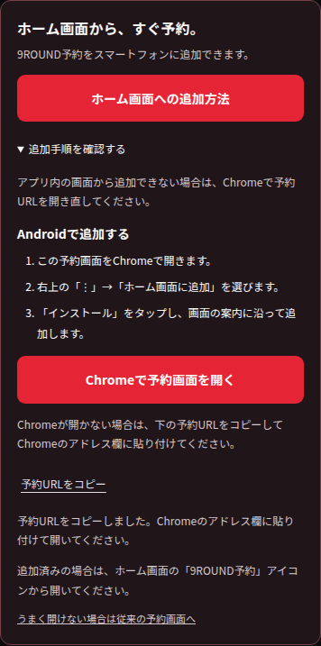
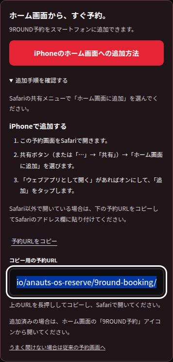

# 予約アプリのインストール案内修正（2026/10/18）

インストール確認画面を開けない場合にも「アプリをインストール」と表示し、押すと説明だけを開いていたため、ボタンの文言と動作を揃えました。

- ブラウザーから`beforeinstallprompt`を受け取った場合だけ「アプリをインストール」を表示します。確認画面を開いている間は連打を止め、使用済みのイベントは再利用しません。
- それ以外は「ホーム画面への追加方法」を表示し、AndroidにはChromeのメニューから追加する手順とChromeを開くIntentリンク、iPhoneにはSafariの共有メニューから追加する手順を表示します。
- アプリ内ブラウザーから開き直せない場合に備え、公開予約URLだけをコピーできます。予約IDやURLフラグメントはコピーしません。クリップボードが使えない場合は選択できるURL欄を表示します。
- インストールの承認・中止・確認画面を開けなかった場合を区別します。ホーム画面から起動した場合は追加案内を表示しません。
- GASの直接画面は既存のインストール用ページへのリンクを維持します。本変更はGitHub Pagesの画面を更新し、予約APIとデータは変更しません。

## 検証

`node tests/9round-pwa.browser.cjs`：Chromeのインストール条件検査でエラーなし。Android・iPhoneの案内、Chromeリンク、URLコピーとコピー失敗時の代替、320px幅、オフライン画面、APIをキャッシュしないこと、GASへの切り戻しを確認しました。インストール確認画面の承認・中止・エラー・連打・完了イベントはテスト用のブラウザーイベントで検証しています。実際のスマートフォンへのインストール完了はこの自動テストの対象外です。

`node tests/9round-cancel-feedback.browser.cjs`：既存の予約済み枠からの取消、連打防止、処理中と完了・エラー表示が引き続き成功しています。

## 案内の根拠

- [Google：ウェブアプリを使用する（Android）](https://support.google.com/chrome/answer/9658361?co=GENIE.Platform%3DAndroid&hl=ja)
- [Apple：iPhoneのSafariでウェブサイトをアプリにする](https://support.apple.com/ja-jp/guide/iphone/iphea86e5236/ios)
- [Chrome：インストール案内の表示条件](https://web.dev/articles/install-criteria)
- [Chrome：Android Intentリンク](https://developer.chrome.com/docs/android/intents)

